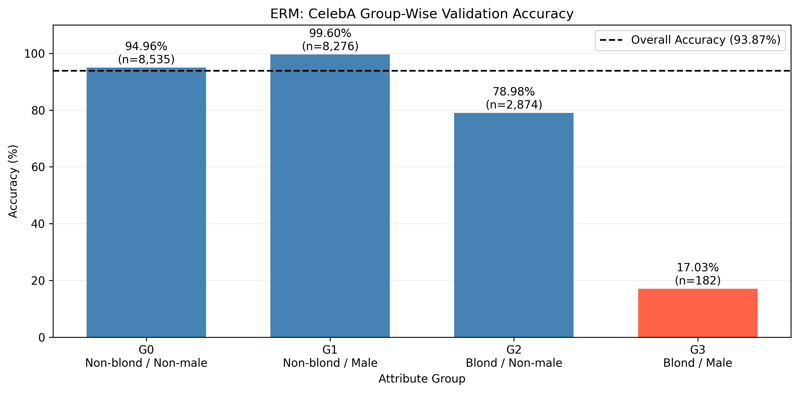

# When Outliers Matter
### Investigating Gradient-Based Data Selection Under Spurious Correlations

UCLA CS 260D — Large-Scale Machine Learning | Fall 2026

## Overview

Deep learning models can achieve high average accuracy while performing poorly on underrepresented groups due to spurious correlations.

This project investigates whether EPIC-inspired gradient-based data filtering disproportionately removes informative minority examples, and how this affects worst-group generalization.

We compare:
- **ERM:** Standard empirical risk minimization
- **EPIC-inspired filtering:** Gradient-space data selection
- **JTT:** Just Train Twice
- **Random filtering:** Equal-size random data removal

## Dataset: CelebA

We use CelebA, containing 202,599 aligned face images and 40 binary attributes.

- Target: `Blond_Hair`
- Spurious attribute: `Male`
- Four evaluation groups defined by these attributes
- Official train/validation/test partitions

### Download

Download the following files from the [CelebA dataset on Hugging Face](https://huggingface.co/datasets/Yuehao/celeba).

Run from the repository root:

```bash
mkdir -p data/celeba

BASE=https://huggingface.co/datasets/Yuehao/celeba/resolve/main

curl -L --fail --retry 3 "$BASE/img_align_celeba.zip" \
  -o data/celeba/img_align_celeba.zip

curl -L --fail --retry 3 "$BASE/list_attr_celeba.txt" \
  -o data/celeba/list_attr_celeba.txt

curl -L --fail --retry 3 "$BASE/list_eval_partition.txt" \
  -o data/celeba/list_eval_partition.txt
```

Verify and extract:

```bash
unzip -tq data/celeba/img_align_celeba.zip
unzip -q data/celeba/img_align_celeba.zip -d data/celeba/

find data/celeba/img_align_celeba -name "*.jpg" | wc -l
```

Expected: `202599` images.

The ZIP may be deleted after successful extraction.

## Environment Setup

Python 3.12 recommended.

```bash
python3 -m venv .venv
source .venv/bin/activate

python -m pip install -r requirements.txt
```

Use the `.venv` kernel when running Jupyter notebooks.

## Experiments

Run notebooks in the following order:

1. `explore_celeba.ipynb` — Dataset analysis, visualization, and metadata preparation
2. `erm_celeba.ipynb` — Pretrained ResNet-18 feature extraction and ERM training
3. `epic_celeba.ipynb` — Gradient-based filtering (planned)
4. `jtt_celeba.ipynb` — Error-based reweighting (planned)

Our feature extractor is an ImageNet-pretrained ResNet-18 with frozen weights, producing 512-dimensional image representations.

Processed metadata and cached features are stored locally in `data/processed/` and are not tracked by Git.

The initial execution of `erm_celeba.ipynb` generates feature caches for training, validation, and testing. Subsequent experiments reuse these cached representations.

## Preliminary Results: ERM

Validation-set results:

| Metric | Accuracy |
|---|---:|
| Overall accuracy | 93.87% |
| Worst-group accuracy | 17.03% |
| Best-group accuracy | 99.60% |

The worst-performing group is `Blond_Hair=1, Male=1`, containing only 182 validation examples.



These findings establish a substantial group-performance disparity, motivating further analysis of gradient-based filtering.

## Reproducibility

- Random seed: 42
- Optimizer: Adam
- ERM learning rate: 0.001
- Batch size: 512 (cached features)
- Epochs: 20
- Checkpoint selection: Minimum validation loss

All methods will use identical feature representations and official data partitions.

Model checkpoints and datasets are excluded from Git. Experimental metrics and visualizations are included.

## References

- Yang et al. (2022). *Not All Poisons are Created Equal: Robust Training against Data Poisoning.*
- Liu et al. (2021). *Just Train Twice: Improving Group Robustness without Training Group Information.*
- Sagawa et al. (2020). *Distributionally Robust Neural Networks for Group Shifts.*
